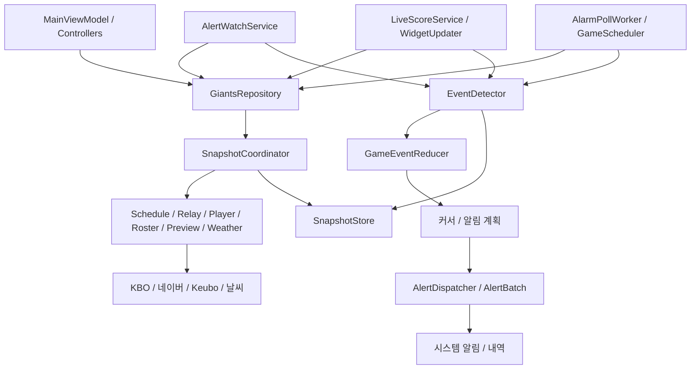

# 조회·알림·화면 상태 구조 (as of 2.0.83)

이 문서는 **구현 계획이 아니라** 현재 `app` 모듈의 구조 설명이다. 실행 단계·파일 allowlist는 없다. 변경 작업은 코드와 테스트를 본다.

Gradle 모듈은 `app` 하나다. 조회·게시·알림·화면 상태의 소유자를 클래스로 나눈다.

## 용어

| 말 | 뜻 |
|---|---|
| 공시 / 등말소 | KBO 공식 선수 등록·말소 발표 |
| Keubo | 보조 이력 API. 공식 인원 목록에 합치지 않는다. 선수 코드 연결만 쓴다 |
| 레이스 | 순위·매직 등 정규시즌 경쟁 알림 축 (`EventDetector`의 race 잠금) |
| 무음 보완 | 이미 올린 득점 알림을 소리 없이 본문만 고치거나 채움 (새 알림이 아님) |
| gated FULL | FULL 조회가 아직 끝나지 않아도 LIVE 게시는 진행하는 경로 |
| seqno | 중계 문장 순서 번호. 뒤로 가는 응답은 최신 경기를 덮지 않는다 |
| DH | 더블헤더. 차전 전환 후 이전 경기 응답은 버린다 |
| 세대 | 팀·선택 경기·KBO 날짜가 바뀌면 올리는 요청 세대. 게시 직전 다시 확인한다 |
| `kboToday()` | 서울 05:00 롤오버 기준 경기일. 공시 “당일” TTL 0은 **달력일**(`LocalDate.now`)이라 00:00–05:00에 어긋날 수 있다 |

## 흐름

## 조회와 게시

`SnapshotCoordinator`는 FULL(전체)과 LIVE(경기)를 나눈다. 같은 종류·팀·선택 경기·날짜의 진행 중 요청은 공유한다. 네트워크는 게시 잠금 밖에서 돌리고, 디스크·메모리 게시만 직렬화한다 (gated FULL).

게시 전과 DataStore 저장 트랜잭션에서 세대·팀·선택 경기·KBO 날짜를 다시 확인한다. 늦은 FULL은 이미 게시한 LIVE 점수·이닝·중계 위에 보조 자료만 합친다. seqno 후퇴·DH 이전 경기 응답은 차단한다.

포스트시즌 당일에는 응원팀 대신 당일(또는 기간) 포스트시즌 경기의 **홈팀**을 포커스로 고른다 (`pickPostseasonOrTeamGame`). 정규시즌·매직/등말소는 설정 응원팀을 쓴다.

화면 LIVE 자동 갱신은 서비스와 같은 경량 경로다. FULL 보조 조회는 별도 작업·최대 1분 간격이다. LIVE 시각으로 FULL TTL을 늘리지 않는다. 강제 새로고침은 완료 캐시를 다시 쓰지 않는다.

## 자료 소유와 공유

도메인 소유자: Schedule / Relay / Player / Roster / Preview / Weather Source.

공유 원칙: 진행 중 같은 키는 `SingleFlight`로 공유한다. 대기자 취소는 소유 조회를 끊지 않는다. 소유 취소는 대기자에게 일반 실패로 넘어가 감시 루프가 죽지 않게 한다. 자료별 TTL·항목 상한은 `TimedSourceCache`가 감싼다(실패는 캐시하지 않음). Weather는 같은 정책이지만 `TimedSourceCache`가 아니라 자체 map + SingleFlight다.

정책 경계(구체 초·개수는 코드 상수):

- Schedule: 당일·과거·시즌 창 TTL, 범위 요청 상한. **조회 실패 시 약 60초 재조회 억제**, 직전 정상 캐시 유지
- Relay: 이닝 캐시·누락 복구, 경기 캐시 상한, 세대 무효화. 누락 이닝 채울 때 **동시 fetch 상한 3**(`Semaphore(3)`). “지난 이닝 최대 3개”가 아니다
- Roster: 달력 당일 공시 TTL 0(매번 확인), 과거·Keubo 이력은 짧은 TTL
- Preview / Weather: 경기·구장별 짧은 TTL + 요청 공유

## 감시와 백업 폴

`AlertWatchService`(FGS)가 라인업·등말소 독립 루프를 돌린다. 실패를 ‘변화 없음’으로 쓰지 않는다.

간격(코드 `AlertWatchGate`): 라인업 창 안·발표 전 짧음 / 발표 후 김 / 창 밖 60초. 등말소 08–23시, 13–18시는 10초·그 외 30초.

알람 `FAST_POLL`·`ROSTER_POLL`은 방송에서 즉시 끝내고 `AlarmPollWorker`(WorkManager KEEP)로 넘긴다. 감시 FGS가 이미 돌면 백업 폴은 알람만 다시 걸고 조회하지 않는다. (방송 `goAsync` 60초 ANR 방지)

## 이벤트와 정책

`GameEventReducer.reduce`는 순수 계산이다. Android·DataStore·네트워크를 부르지 않는다. 다음 커서·알림·통합 취소·득점 ID·지연 상세의 무음 보완·정정을 결과에 넣는다. 포스트시즌 경기는 중립(양팀) 알림으로 본다.

`EventDetector`는 경기 / 라인업 / 등말소 / 레이스 잠금을 나눈다. 시즌이 끝난 팀에는 「등말소 변화 없음」을 내지 않는다.

`AlertDispatcher`는 배치 시작 시 정책을 한 번 읽는다. `AlertBatch`는 LIVE 여부·진동·**알림 마스터(`masterEnabled`)** 를 인자로 받아 `shouldEmitAlert`에 넘긴다. 마스터가 꺼지면 종류·프리셋 설정과 무관하게 이벤트·라이브 바·감시를 올리지 않는다. 배치 경로에서 발행 중 DataStore/`runBlocking` 조회를 하지 않는다.

복구 커서는 typed JSON(이름·숫자·불리언·주자·득점 원장·무음 보완 상태)으로 저장한다. 예전 파이프 문자열과 `parts` 배열 JSON도 읽기만 한다.

## 화면 요청

`PlayerDetailController`, `PlayerRosterController`, `CalendarController`, `EntryController`가 요청/상태를 소유한다. `LatestRequest`는 선택 변경 시 이전 작업을 취소하고 게시 직전 취소·세대를 다시 본다. 이전 조회가 취소를 무시해도 새 선택을 덮지 않는다. 이전 작업의 finally는 새 작업 로딩을 끄지 않는다.

MainViewModel은 공개 화면 API를 유지하고 컨트롤러 상태를 연결한다. 라이브 스냅샷을 결과 목록에 합치는 표시는 ViewModel에 남긴다. 결과 탭 팀 필터 기본값은 「전체」다.

전적 `RecordDisplayScope`는 실제 응답 날짜로 월·조회 범위를 쓴다. `EntryDayResult`는 미조회·실패·확인된 공시를 나눈다. 최근 7일(동시 최대 3)·선택 날짜·변동 날짜는 각각 LatestRequest다.

## 검증과 한계

동시성 비교(의도):

| 항목 | 이전 | 지금 |
|---|---|---|
| FULL이 느릴 때 LIVE | 같은 mutex 대기 | gated FULL이어도 LIVE 게시 가능 |
| 동시 동일 경량 요청 | 직렬 후 짧은 캐시 | 진행 중 요청 1회·게시 1회 공유 |
| 알림 정책 | 알림마다 DataStore | 배치 시작 1회 + 마스터·진동 전달 |
| 오래된 화면 요청 | 취소 무시 후 게시 가능 | 취소·세대 확인 후 게시 |

단위 테스트·중계 픽스처 재생으로 동시성·커서·EntryDayResult를 검증한다. API 속도 %·절전·실경기 종단 지연·공시 발행 속도는 현장 확인 범위다.

## 유지·확장 시

허용 표면: 해당 Source / Coordinator / Detector·Reducer / Alert* / Controllers / 관련 테스트. 불변: FULL/LIVE 분리 게시, 세대 가드, Reducer 순수성, 실패≠무변동, 알림 마스터가 종류 설정을 지우지 않음.
